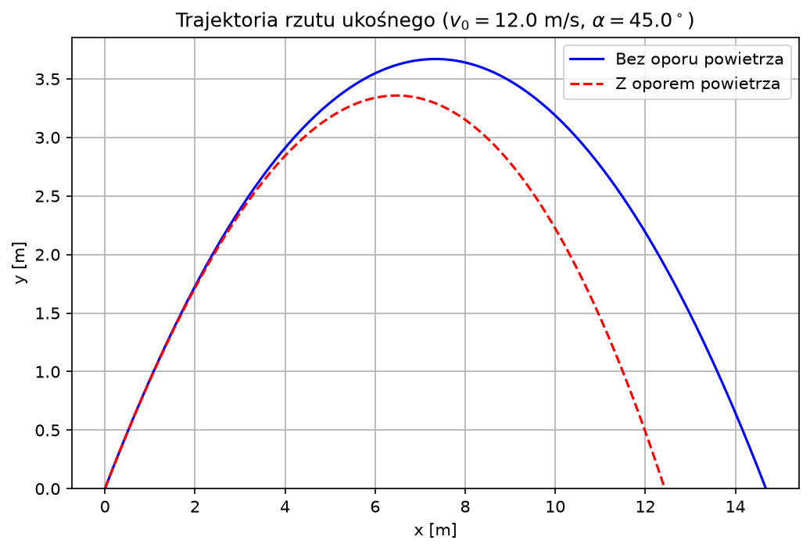
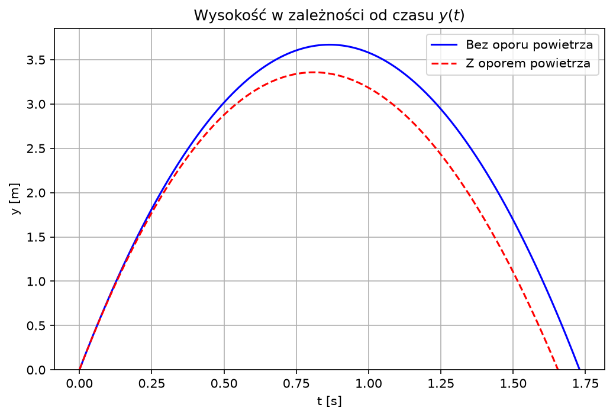
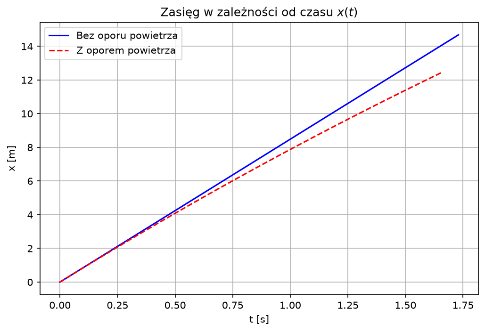

# Raport: Analiza Rzutu Ukośnego

## 1. Cel i Parametry

Celem raportu jest porównanie rzutu ukośnego bez oporu powietrza oraz z uwzględnieniem oporu lepkiego ($\mathbf{F}_{op} = -b\mathbf{v}$).

| Parametr | Oznaczenie | Wartość | Jednostka |
| :--- | :---: | :---: | :---: |
| Prędkość początkowa | $v_0$ | **12.0** | m/s |
| Kąt wyrzutu | $\alpha$ | **45.0** | deg ($^\circ$) |
| Przyspieszenie ziemskie | $g$ | **9.81** | m/s² |
| Masa ciała | $m$ | **1.0** | kg |
| Współczynnik oporu | $b$ | **0.15** | kg/s |

---

## 2. Równania Ruchu

### Bez oporu powietrza
$$x(t) = v_0 t \cos\alpha$$
$$y(t) = v_0 t \sin\alpha - \frac{1}{2}g t^2$$

### Z oporem powietrza ($k = b/m$)
$$x(t) = \frac{v_0 \cos\alpha}{k} \left(1 - e^{-kt}\right)$$
$$y(t) = \frac{1}{k} \left(v_0 \sin\alpha + \frac{g}{k}\right)\left(1 - e^{-kt}\right) - \frac{gt}{k}$$

---

## 3. Wykresy i Wizualizacja

### Trajektoria ruchu $y(x)$

### Zależność wysokości od czasu $y(t)$

### Zasięg poziomy w czasie $x(t)$

---

## 4. Wnioski
- Opór powietrza powoduje skrócenie zasięgu rzutu oraz zmniejszenie maksymalnej wysokości.
- Trajektoria z oporem powietrza nie jest symetryczną parabolą — opadanie jest bardziej strome niż wznoszenie.
